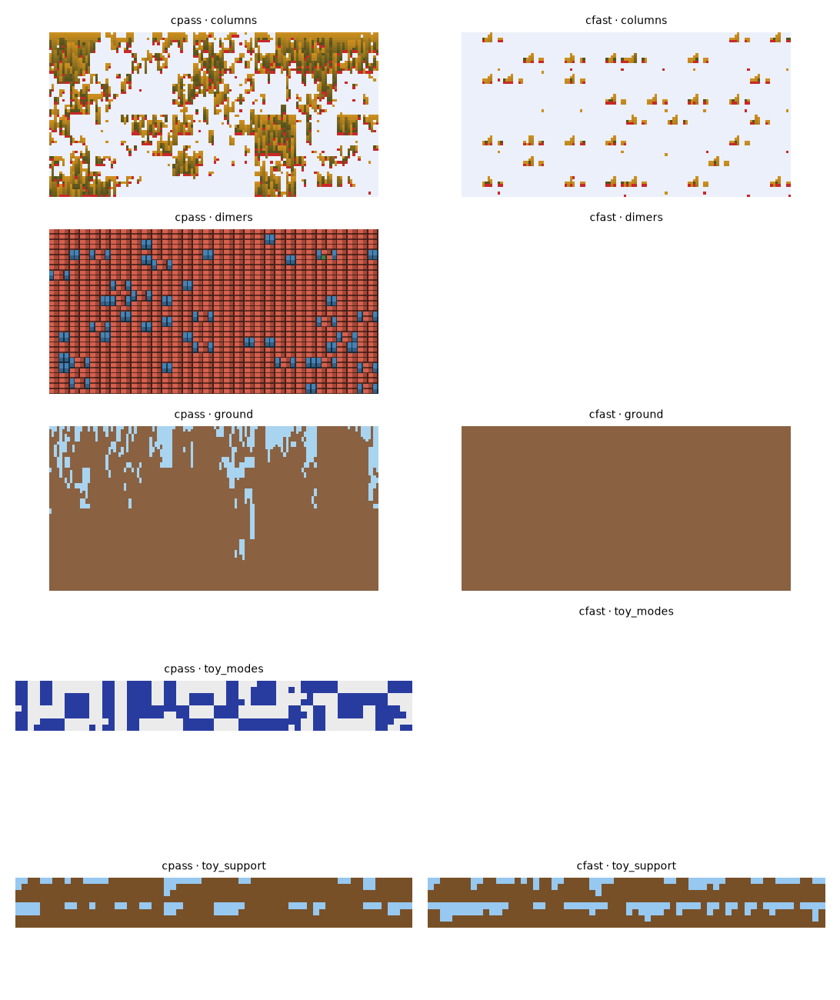

# cfast: throughput and dependency-cone returns

2026-10-13 · `castlegen/variants/cfast.py`, `_cfast_cone.py`, `_cfast_core.py`, `tests/variants/test_cfast_cone.py` (10 pass). The agent's text, saved by the orchestrator.

**Verdict.**
- Updates are 5–12× faster.
- Ground and columns now train well within 150 s.
- Training finds degenerate modes fast: ground fills with dirt and columns empties to air.
- Nothing is accepted.

## What changed (all unbiased)

- **Dependency-cone returns.** `fine_reach` gives each step's fine-cell reach, derived from the actor window and every factor touching the channel. `Cone` grows a hull over later steps.
  - G is a sum of box sums over per-step integral images.
  - Tests check that every cost changed by a random single-draw replacement lies in the cone, on all five problems.
- **Critic** reads the actor's first hidden layer (pre-update, no gradient) plus τ, λ and the step fraction. No separate critic windows.
- **Subsampled loss:** 64 sites per (step, world), weighted n/m.
- **Replays:** K = 0 by default.
- **One fused jitted update:** lr 3e-3; τ anneal over the first 20 % of the time left after setup.
- **Shared compiled functions** across instances, so seed 1 pays no compile.

## Speed (shared machine)

| problem | cpass s/update | cfast s/update | speed-up |
| --- | --- | --- | --- |
| ground | 5.19 (1.3–1.7 at low load) | 0.43 | 12× (4× at low load) |
| columns | 0.89 | 0.16 | 5.7× |

cpass's record pass stored 8×8 + 7×7 critic features for every draw (about 480 MB), which took about 1 s of each update.

## Cone variance reduction (ground, untrained, critic off)

- **Cone size** as a share of all later draws: 2.4 % (l0), 23 % (l1), 64 % (l2), 94 % (l3), 99.9 % (l4).
- **Gradient variance, every-later-draw ÷ cone:** 357× (l0), 8.0× (l1), 1.8× (l2), 1.2× (l3), 1.0× (l4).
- **Bias:** paired differences are consistent with none.

## Bench (2 seeds × 150 s)

| problem | variant | updates | worst final viol | F / cell | notes |
| --- | --- | --- | --- | --- | --- |
| toy_support | cpass | – | 2.4e-4 | −0.374 | |
| toy_support | cfast | 8600–9000 | 2.0e-3 / 4.9e-4 | **−0.441** (KL 0.028) | dirt 0.78 vs 0.72 |
| ground | cpass | 60 | 7.0e-2 | 1.92 | |
| ground | cfast | 648 / 549 | **0** / 2.9e-2 | 0.885 | all dirt (0.99–1.0) |
| columns | cpass | 168 | 1.6e-1 | −0.83 | |
| columns | cfast | ~1110 | 2.1e-2 | −0.05 | all air (density 0.02–0.06 vs 0.82) |

## Conclusions

- **Throughput and credit assignment at the fine levels are no longer the bottleneck.**
- **The modes found are degenerate.** All dirt and all air are valid, cheap states.
- **The coarse levels stay noisy.** Their cones are near global, with an SNR of about 0.02 at level 4. Coordinating 12-cell columns is hard for them, so zero counts are the safe plan.
- **This is the entropy and mode-collapse problem** (ideas #1), which slow training used to hide.

## Next

1. An entropy-preserving schedule on top of cfast.
2. Coupled replays for many coarse draws per world, each within its cone.
3. A smaller actor window for tighter cones at levels 1–2.

## Files

- Figures: `samples.png`, `curves_cfast_*.png`.
- Data: `speed_*.json`, `gradvar_*.json`.
- `scripts/`.
