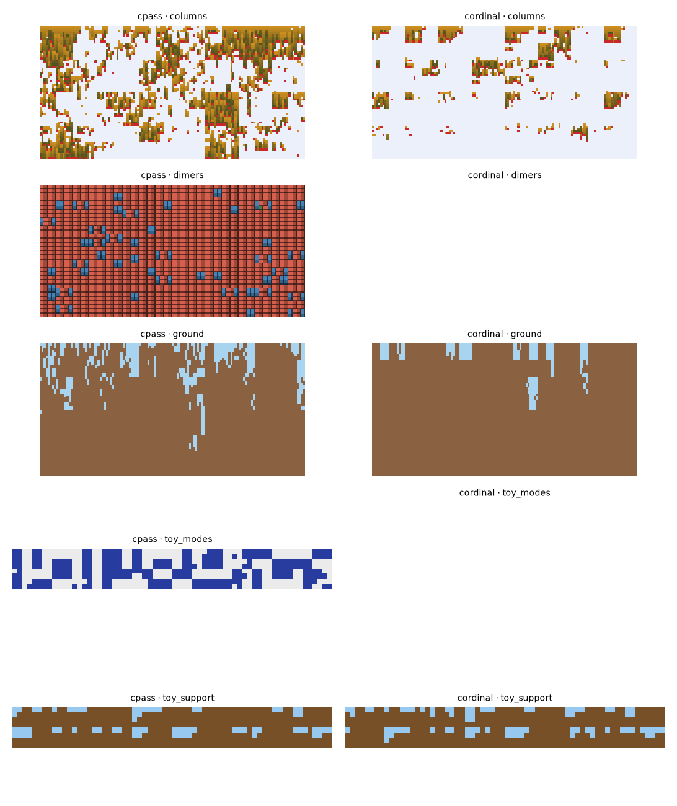

# cordinal: ordinal encodings and smooth heads (ideas.md #6)

2026-10-13 · `castlegen/variants/cordinal.py`, `_cordinal_core.py`, `tests/variants/test_cordinal.py` (4 pass). The agent's text, saved by the orchestrator.

cpass with its estimator unchanged; an A/B test of the actor's head and input encoding.

## Changes

- **(a) Input encoding.** Views with more than 8 values get a 16-bin piecewise-linear thermometer code. Views with at most 32 values also get an exact one-hot.
- **(b) Smooth head.** For channels with D > 8: b(v) = Σ_view Σ_{k=1..8} c_{view,k} cos(πk·u_view(v)) + 0.1·r_v.
  - The smooth views are every non-id view with more than 8 values, or the id view if there is none.
  - The certificates use their A and B views; counts use their id order.
- **(c) Mask-relative coordinates.** u = clip((view(v) − lo) / max(hi − lo, 1), 0, 1), with [lo, hi] the range of the view over the least-violating set A.

## Bench (2 seeds × 150 s)

| problem | variant | worst final viol | F / cell | updates |
| --- | --- | --- | --- | --- |
| toy_support | cpass | 2.4e-4 | −0.374 | 1755 / 2049 |
| toy_support | cordinal | 2.0e-3 (one repaired cell) | −0.387 (KL 0.082) | 1774 / 2560 |
| ground | cpass | 7.0e-2 | 1.918 | 60 / 48 |
| ground | cordinal | **2.9e-2** | 1.846 | 58 / 52 |
| columns | cpass | 1.5e-1 | −0.829 | 168 / 135 |
| columns | cordinal | 1.5e-1 | −0.645 (seed 0 near empty) | 94 / 86 |

## Ablation (ground)

| variant | a | b | c | worst final viol | F / cell | floating cells |
| --- | --- | --- | --- | --- | --- | --- |
| cpass | – | – | – | 7.0e-2 | 1.918 | 1137 / 1130 |
| cordinal_a | ✓ | – | – | 9.0e-2 | 1.984 | 1183 / 1074 |
| cordinal_ab | ✓ | ✓ | – | 4.3e-2 | 1.878 | 1010 / 276 |
| cordinal | ✓ | ✓ | ✓ | 2.9e-2 | 1.846 | 153 / 651 |

- **(b) carries the gain.** About 16 coefficients per certificate learn faster than 153 independent logits.
- **(c) probably helps,** but stays within the seed spread.
- **(a) alone does nothing.**

On ground, some of the improvement is bought with excess dirt (seed 0: dirt 0.957), which is entropy loss.

## Confound

Encoding (a) also feeds the critic's wide windows, which grows its input 3–5×. Columns ran about half as many updates as cpass. Rerun with the critic on cpass's encoding before drawing conclusions about columns.

## Next

1. Keep the critic's encoding small, then rerun columns.
2. Combine with cfast's throughput.
3. Run more seeds for (c).
