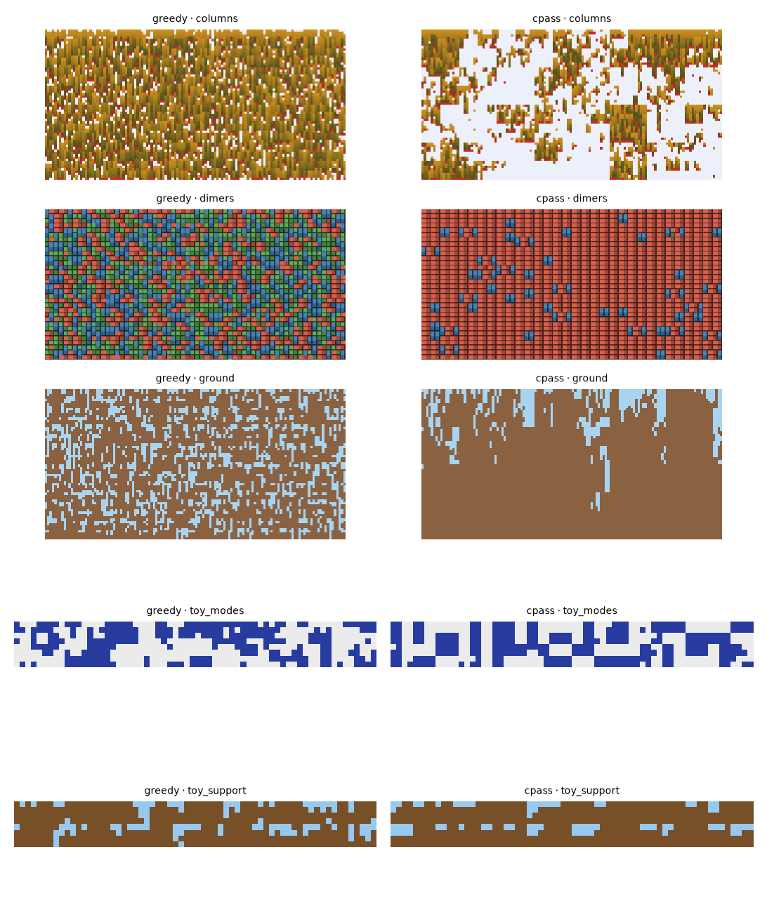
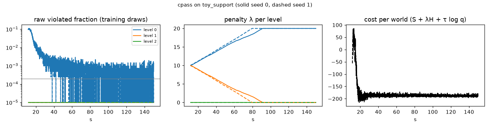
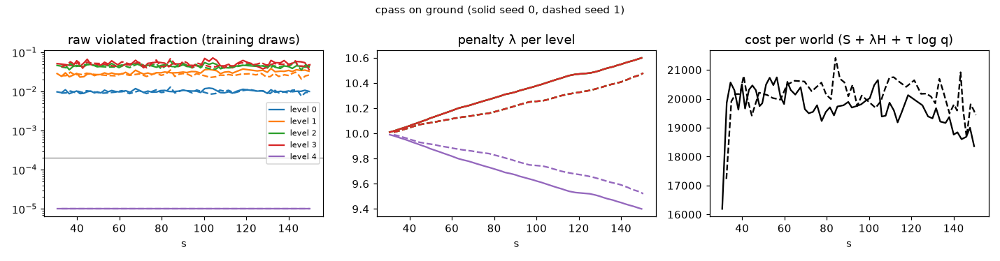

# cpass: first results

2026-10-13 · branch `coloured-pass` · harness `castlegen/bench`, variant `castlegen/variants/cpass.py`

The reference variant (the final spec as written) runs on all five problems.
On the small problems it gets raw violations down to about 1e-4, but it loses
entropy. It under-samples non-mode states, and on dimers it collapses to an
almost fully horizontal tiling. On ground and columns it fits too few updates
in 150 s to learn anything. No run passes acceptance.

## Bench (2 seeds × 150 s training, 16 held-out worlds per seed)

| problem | variant | worst final viol | free energy / cell | optimal F / cell | main failure |
| --- | --- | --- | --- | --- | --- |
| toy_support | greedy | 7.3e-01 | -1.000 | -0.469 | violations |
| toy_support | **cpass** | 2.4e-04 | -0.374 | -0.469 | KL 0.095 / cell: too much dirt (0.85 vs 0.72), flat blocks 35 % vs 10 % |
| toy_modes | greedy | 5.9e-01 | -0.182 | 0.251 | violations |
| toy_modes | **cpass** | 0 | 0.263 | 0.251 | KL 0.013 / cell: the 4 modes are balanced, but non-mode states are 13–16 % vs 26 % |
| dimers | greedy | 4.0e-02 | -0.772 | – | violations |
| dimers | **cpass** | 8.2e-04 | -0.094 / -0.004 | – | mode collapse: 91 % / 99.9 % horizontal dimers (about 1/3 by symmetry) |
| ground | greedy | 2.1e-01 | 1.30 | – | violations |
| ground | **cpass** | 7.0e-02 | 1.92 | – | 60 updates; violations unchanged from untrained |
| columns | greedy | 7.5e-01 | -1.98 | – | violations |
| columns | **cpass** | 1.6e-01 | -0.83 | – | 168 updates; density 0.39–0.47 vs 0.82 exact |

- **Free energy** is E_q[S + log q] per fine cell on raw draws. On the toys, minus the exact optimum (−log Z per cell, by enumeration), it is the reverse KL per cell. A greedy free energy below the optimum means it scores well only because it violates the hard constraints.
- **Finite support** holds exactly for every run: overlapping windows give identical output.
- **Probes** are flagged wherever they can be scored. Valid states from other sources get far less probability than the sampler's own draws.

*One final world per problem. Left: greedy (untrained). Right: cpass.*

## What the curves show

- **toy_support**:
  - Raw violations fall from 10 % to about 1e-3 in 10 s, then stall around the 2e-4 budget.
  - λ at level 0 rises to the cap of 20 and stays there.
  - The sampler's escape is to favour full, flat columns. Those states are easy to keep valid but carry little entropy, so the penalty buys validity with entropy.
- **toy_modes and dimers**: the same pattern without the penalty at the cap. Reverse KL drifts to low-entropy solutions: one orientation dominates the dimers, and the toy under-samples states outside the four modes.

- **ground**: about 2.5 s per update (8 worlds plus 32 coupled replays of the full hierarchy) and about 30 s of compilation. That leaves 60 updates, and nothing moves.
- **columns**: 168 updates. The sampler learns to leave cells empty, which avoids violations but cuts density to half of the target.

## Other observations

- **Repair moves violations between levels.** It never increases the total, but on ground it raises level-4 violations from 0 to 7 % while lowering the finer levels.
- **Returns use every later draw**, the spec's allowed conservative superset of D_i. Each draw's return therefore sums about 10^4 terms on ground.
- **Not yet built from the spec:**
  - the gradient test on an enumerable hierarchy (test 5);
  - the signal-to-noise gate;
  - the coverage probe's τ = 2 checkpoint set.

  The gradient test matters most: until it passes, estimator bias can't be ruled out as the cause of the entropy loss.

## Bug found and fixed in the harness

The noise module's float32 uniform could round to exactly 1, which gives an infinite Gumbel. A masked candidate then won the argmax through NaN. It now uses 23 bits, with a regression test. All results above use the fixed harness.

## Proposed next steps (for the agent rounds)

1. **Gradient test first:** check the estimator against exact differentiation on toy_support. It separates estimator bias from optimisation problems.
2. **Entropy loss:** τ schedules and softened constraints during training (ideas.md #1), λ dynamics, and how much each draw's entropy term is weighted.
3. **Throughput on ground and columns:**
   - fewer replays;
   - reuse the recorded pass;
   - restrict D_i by a dependency cone;
   - smaller training strips.

   The GPU move belongs here too.
4. **Truncated-depth training** (ideas.md #2) as a bias-for-variance alternative, which needs your approval under constraint 3.
