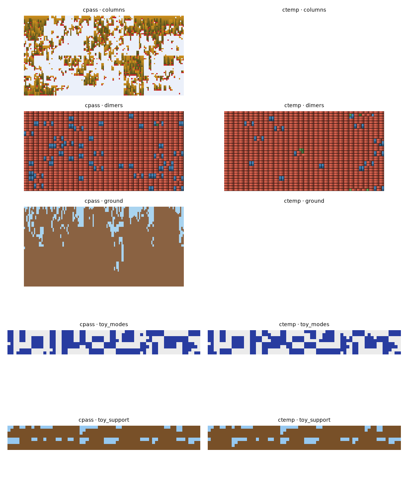
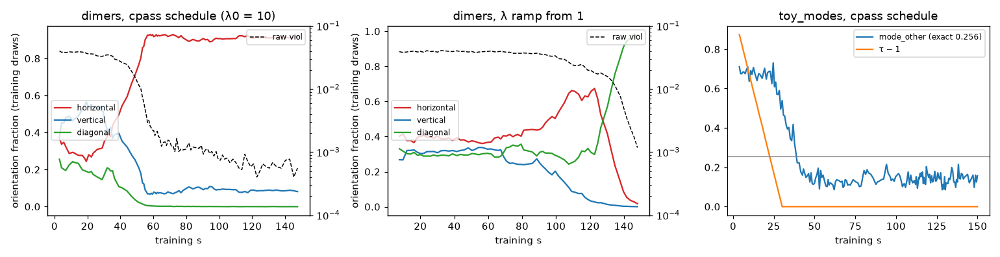

# ctemp: temperature-conditioned training against cpass's entropy loss

2026-10-13 · `castlegen/variants/ctemp.py` (+ `_ctemp_core.py`), `tests/variants/test_ctemp.py` (3 pass). The agent's text, saved by the orchestrator.

**Verdict: no improvement.** τ schedules, a τ-conditioned actor and soft starts for λ leave cpass's entropy loss unchanged within seed noise. Nothing is accepted.

## What ctemp is

cpass with its estimator unchanged, plus:
- **Per-level temperatures τ_l.** The actor reads log τ_l, and the critic reads the τ and λ vectors.
- **Schedules:**
  - `anneal`: cpass's 2 → 1.
  - `mix`: every level at τ ~ log-U[1, 3], with p(τ = 1) = 0.25.
  - `coarse` (the default): as `mix`, but only levels above the finest are heated.
  - All three spend the last 50 % of the budget at τ = 1.
- **λ controller:** steps only on batches where every level is at τ = 1.

## Bench (2 seeds × 150 s; KL per cell = free energy − exact optimum)

| problem | variant | worst final viol | KL / cell (s0, s1) | stats (s0; s1) |
| --- | --- | --- | --- | --- |
| toy_support | cpass | 2.4e-4 | 0.096, 0.092 | flat 0.35; 0.35 (exact 0.096) |
| toy_support | ctemp | 4.9e-4 | 0.095, 0.089 | flat 0.40; 0.34 |
| toy_modes | cpass | 0 | 0.013, 0.011 | non-mode 0.13; 0.16 (exact 0.256) |
| toy_modes | ctemp | 0 | 0.012, 0.014 | non-mode 0.14; 0.16 |
| dimers | cpass | 8.2e-4 | F −0.094, −0.004 | horizontal / vertical / diagonal 0.91 / 0.09 / 0; 1.00 / 0 / 0 |
| dimers | ctemp | 1.3e-3 | F −0.058, −0.017 | horizontal / vertical / diagonal 0.96 / 0.04 / 0; 0.01 / 0 / 0.99 |

Probes are flagged on every scorable seed of both variants. Finite support holds everywhere.

## Diagnosis

**dimers: collapse comes late, at τ = 1, as violations fall.**
- Orientations stay near 1/3 for 40 s.
- Between 40 and 55 s, violations fall from 3 % to 0.3 % and horizontal rises to 0.92.
- Ramping λ up from 1 only delays this: orientations stay balanced while λ < 8, then collapse (to diagonal) at λ ≈ 9–11.

**toy_support: entropy is the price of validity under the penalty.**
- At λ = 1, the stats are near exact (flat 0.07), but violations are 14 %.
- As λ rises to 20, flat blocks return to 0.35–0.45 and violations fall to 5e-4.
- The end point is about −0.38 / cell however λ gets there.

**toy_modes: exact KL split per 4×4 block** (120 s, 1 seed):

| schedule | coarse KL / block | fine KL / block | total / cell |
| --- | --- | --- | --- |
| cpass | 0.10 | 0.22 | 0.020 |
| ctemp coarse | 0.16 | 0.15 | 0.019 |
| cpass B = 32 | 0.57 | 0.38 | 0.059 |

- The fine conditional is exact in mode contexts but 0.6–1.0 nats per block off in non-mode contexts, so the coarse level learns to avoid those.
- The non-mode fraction falls from 0.54 to 0.19 within 13 s of reaching τ = 1 and never recovers.
- Heating only the coarse levels improves the fine conditionals, but the coarse level then ends worse.

## Conclusions and next

- **Suspected mechanism (not proven):** credit assignment for the draws that set up later violations or later entropy, namely the coarse counts and early partner claims.
- Their signal arrives only through full-world returns and an on-policy critic that is worst on exactly the rare actions that would restore entropy.

**Next:**
- Dependency-cone returns, and coupled replays at every level.
- Then the `coarse` schedule again.
- For dimers, multiple passes per level (ideas #3).

## Files

`ctemp.py`, `_ctemp_core.py`, `test_ctemp.py`. Scripts in this folder: `runexp.py`, `logsum.py`, `kl_split.py`, `table.py`, `diag_fig.py`.
