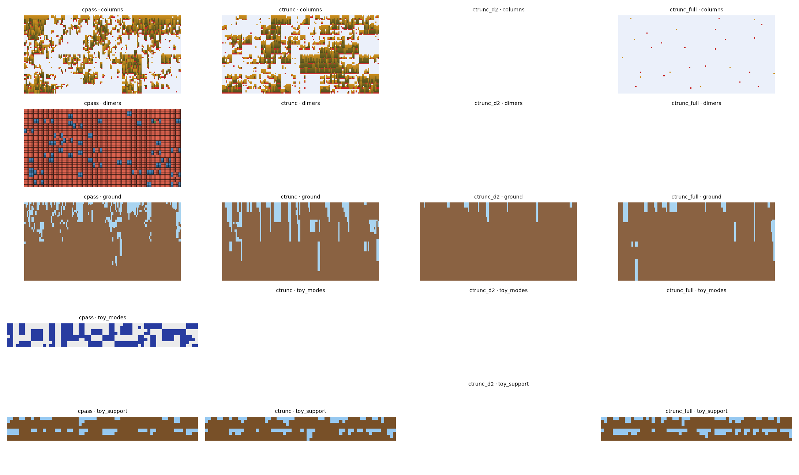

# ctrunc: truncated-depth, bootstrapped training (ideas.md #2)

2026-10-13 · branch `coloured-pass` · variants `ctrunc` (d = 1), `ctrunc_d2`, `ctrunc_full`. The agent's text, saved by the orchestrator.

This variant uses the user's approved exception to constraint 3, so its gradient is biased by design. Generator, objective, τ anneal and penalty rule are cpass's; only the training signal changes.

**Verdict.**
- No run is accepted.
- Updates per second are 2–5× cpass's.
- The extra realised depth helps: depth 1 (pure bootstrapping) is the worst setting, and d = 2 or full depth is best on ground.
- On columns, full depth collapses to an empty world.

## Method

- **Chain:** coarse to fine, with batches that shrink toward the fine level.
  - B_l worlds at level l, about 2048 cells per update, at most 64 worlds.
  - ground and columns use B = 1, 1, 4, 16, 64 for levels 0..4.
  - Start states are the model's own coarse draws, so training is on-policy.
- **Returns:** a 7×7 box sum of later same-level costs, plus a downstream map: realised costs for d − 1 levels below, then a per-cell learned value v_m.
- **Value v_m:** the sampler's encoder over a 6×6 same-level and 5×5 parent window, plus τ and λ.
  - It is regressed on the d-step target, bootstrapped across levels.
  - Its scale and offset are calibrated from the first batch.
- **Losses:** cpass's actor and critic, without coupled replays.

## Bench (2 seeds × 150 s; throughput ±30 % because other benches ran at the same time)

| problem | variant | updates/s | worst final viol | F / cell |
| --- | --- | --- | --- | --- |
| toy_support (opt −0.469) | cpass | ~12 | 2.4e-4 | −0.374 |
| | ctrunc d1 | 11–12 | 3.9e-3 (raw 5e-4) | **−0.441** |
| | ctrunc_full | 15 | 4.9e-4 | **−0.445** |
| ground | cpass | ~0.4 | 7.0e-2 | 1.92 |
| | ctrunc d1 | 1.7–2.0 | 8.4e-2 (level 4); levels 0–2: 2e-3 / 6e-3 / 1.9e-2 | 1.05 |
| | ctrunc_d2 | 2.3–3.0 | s0 1.0e-3, s1 3.5e-2 | 0.74 |
| | ctrunc_full | 2.2–2.3 | 4.3e-2; levels 0–2: 5e-4 / 1.6e-3 / 6.9e-3 | **0.72** |
| columns (exact density 0.82) | cpass | ~1.1 | 1.5e-1 | −0.83 |
| | ctrunc d1 | 4.2–4.9 | 9.9e-2 | −0.61 |
| | ctrunc_full | 6 | 1.3e-2 | −0.03 (empty world, density 0.003) |

F excludes the inf entries, so compare it only between runs with similar violation rates.

- **toy_support:** reverse KL falls from 0.095 to 0.024–0.028 nats per cell, but entropy is still too low (flat blocks 15–25 % against an exact 10 %).
- **ground:**
  - Fine-level violations are 4–15× lower than cpass's.
  - Repair still pushes violations up to level 4 (raw 0, final 4–8 %).
  - The near-valid d2 seed 0 run fills almost everything with dirt (dirt 0.986).

## Bias of the value

Bias is measured as the pre-update estimate against the realised downstream cost, per fine cell, over the second half of training.

| run | mean bias | corr | rmse vs sd |
| --- | --- | --- | --- |
| ground d1 | ≤ 0.015 | 0.09–0.56 | 0.09–0.15 vs 0.05–0.11 |
| ground full | ±0.005 | 0.43–0.73 | ≈ |
| columns d1 | ±0.006 | 0.42–0.76 | ≈ |
| toy_support d1 | −0.002 | 0.49–0.71 | 0.03–0.04 vs 0.04 |

- **V is calibrated in the mean but weakly informative between worlds** (`value_*.png`).
- **At d = 1 the coarse levels get little useful credit.** Their gradient comes from differences in V between actions, which are mostly noise.
- **The gain is throughput and local returns, not the bootstrap.** Each realised level helps: ground F 1.05 → 0.74 → 0.72.

## Conclusions and next

- **Use as much realised depth as is affordable**, with V only where a world stops.
- **The main failure is unchanged:** violations are traded for entropy (all-dirt ground, empty columns, flat toy blocks). That is a problem with the objective and the penalty dynamics.
- **Next:**
  - full-depth chain as the default, with B_0 ≥ 2;
  - combine with temperature or soft-constraint schedules;
  - a repair round that doesn't push violations to the coarsest level;
  - a Q-style value at the truncation level;
  - run the gradient check on this estimator.

## Files

- `castlegen/variants/ctrunc.py`, `_ctrunc_core.py`.
- `tests/variants/test_ctrunc.py` (4 pass).
- Scripts in this folder: `analyse.py`, `summary.py`, `quick.py`, `profile.py`.
