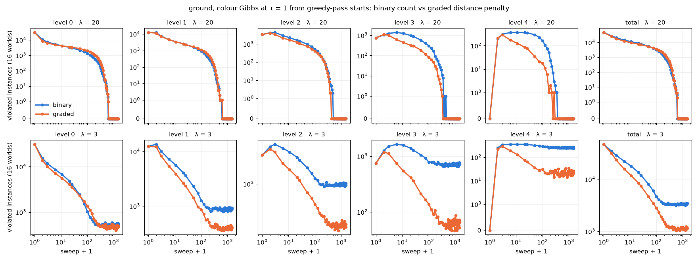

# cgraded: MCMC with a graded vs a binary constraint penalty (ideas #21), 2026-10-14

Sanity check requested by the user: does a graded (distance-to-feasibility) penalty guide MCMC to valid states better than the plain count of violated instances?

## Setup
- **Problem:** ground, periodic W = 128, H = 64.
- **Sampler:** 16 worlds, castlegen.kernels.colour_gibbs exact single-cell Gibbs at τ = 1. Each sweep visits levels coarse → fine, 16 colours each.
- **Starts:** both arms start from the same untrained greedy-pass draws. Start violations at levels 0–4 are 31072 / 12434 / 3356 / 748 / 0.
- **binary:** E = S + λ·(number of violated hard instances).
- **graded:** E = S + λ·Σ d_f. d_f is the L1 distance in table-index space from the instance's entry to the nearest finite entry of its table, so d_f = 0 iff the factor is satisfied. It is built generically from the tables (`graded_table` in run.py). On ground:
  - support gives B − A;
  - honour A gives the shortfall;
  - honour B gives the excess.
- Violations are always counted on the original problem (bench `energy`).
- **Scope:** diagnostic only. Nothing is trained, and the objective and constitution are untouched.

## Results ([figure](violations.png))

**λ = 20, effectively hard.** At λ ≥ 20 the penalty swamps the Gumbel noise in every single-cell conditional. λ = 20 and λ = 200 gave bit-identical chains in both arms. Both arms are therefore "minimise the violation measure, then sample soft energy among the ties".

| | first-valid sweep, median (range) | valid worlds @500 / @600 / @800 | line_match | roughness | soft E |
|---|---|---|---|---|---|
| binary | 488 (400–625) | 10 / 15 / 16 | 0.685 ± 0.022 | 1.38 ± 0.18 | 1236 |
| graded | 500 (425–650) | 9 / 14 / 16 | 0.677 ± 0.029 | 1.35 ± 0.17 | 1232 |

- Time to validity is a tie (25-sweep resolution, 16 worlds).
- Graded clears the coarse levels much sooner: level 4 is clean by sweep 300 against about 400, and level 3 lags binary by about 100 sweeps less.
- Graded leaves more fine-level (0–1) violations mid-run, and those set the finish.
- Final valid samples have the same stats, so there is no sign of distortion.

**λ = 3, soft.** Neither arm ever produces a valid world.
- Graded plateaus at about 1150 total violations, binary at about 3300.
- Levels 2–4 are about 6–10× lower under graded.
- This is a different stationary distribution, not only better guidance: graded charges λ·d ≥ λ per violation, so it is effectively a stronger penalty.

## Reading
- The graded signal does what it promises at the coarse levels, where distances are large (counts and certificates up to 16). It gives those cells a slope, and they untangle faster.
- At level 0 the distance is always 1, so the signal is the same as binary there. The bottleneck on ground is the last fine-level violations, and the slope doesn't help those.
- So on this problem a single-site chain gains nothing in time to all-valid.
- This is consistent with ideas #20: what's left over is local, fine-level tangles. Block or joint moves (coarse cell plus children) are more likely to help there than a different scalar penalty.

## Files
- `run.py`: the experiment (`PYTHONPATH=. python reportables/2026-10-14_cgraded/run.py lam=20 sweeps=1500 B=16`, about 1 min per arm on the Mac).
- `summary.py`, `plot.py`.
- `result_lam{20,3}.json`, `log_lam{20,3}.txt`, `final_*.npz`.
