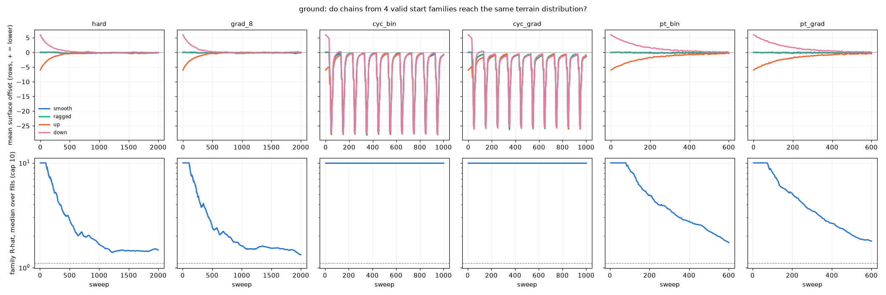
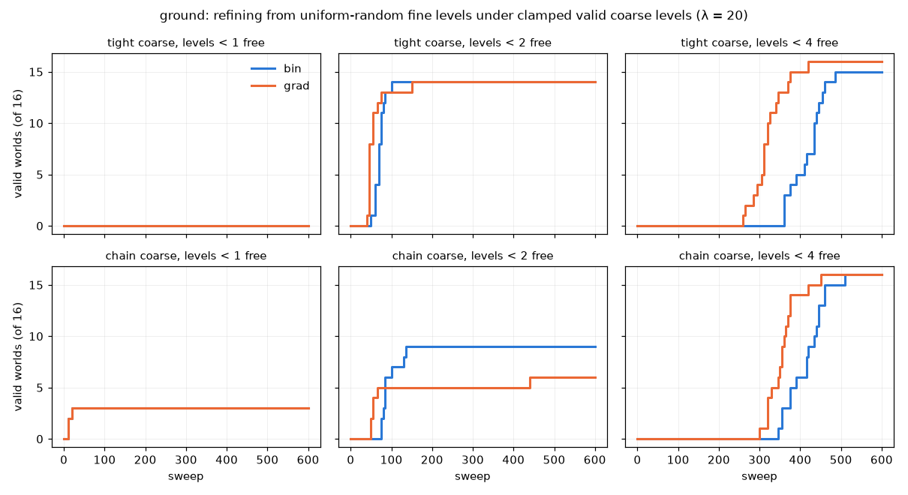
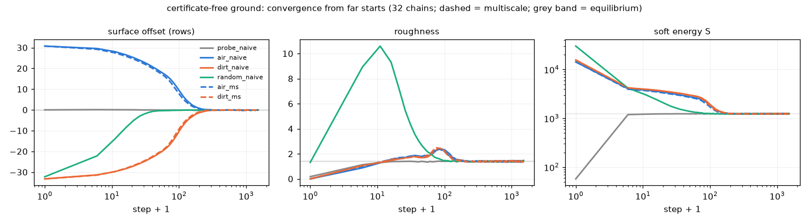

# cmix: how well does MCMC move between terrains, and refine clamped coarse levels? (2026-10-14)

Diagnostics asked for by the user. Nothing is trained; the objective and constitution are untouched.
- **Problem:** ground, periodic W = 128.
- **Sampler:** castlegen.kernels.colour_gibbs, exact single-cell sweeps (levels coarse → fine), τ = 1.
- **Penalties:** "bin" = λ × violated count; "grad" = λ × Σ distance to feasibility (equal to castlegen/graded.py's d on ground).
- **Run on the Mac.** Note: the Mac was swapping heavily (31 of 32 GB swap in use by other processes), and one arm (bin_8) slowed 15× because of it. The wall-clock seconds below come from runs without swap stalls.

## 1. Moving between terrains (`mix.py`, `analyse.py`)

**Setup.**
- 8 fill seeds × 4 valid start families = 32 chains. The families share each fill:
  - smooth surface on the line;
  - 3-row jitter;
  - shifted 6 rows up;
  - shifted 6 rows down.
- Measured on valid states only:
  - surface offset from the designed line;
  - roughness;
  - Fourier modes 1–2 of h − line;
  - soft energy S;
  - integrated autocorrelation time τ (second half of the run);
  - sweeps until the shifted families recover half / 90 % of their offset;
  - an R-hat across the 4 families on the window [t/2, t].

 (pilot λ = 3 / 8 arms: [pilot.png](pilot.png))

| arm | fraction valid | τ offset / τ mode 1 (sweeps) | shift recovered ½ / 90 % (sweeps) | s/sweep (32 chains) | notes |
|---|---|---|---|---|---|
| hard (violations excluded) | 1.0 | 83 / 73 | 110 / ~395 | 0.055 | family R-hat 1.47 @2000 (means agree within 0.1 rows) |
| bin λ = 8 | 0.40 | – | 110 / 345–440 | – | |
| grad λ = 8 | **0.79** | – | 110 / 370–405 | 0.056 | |
| bin λ = 3 / grad λ = 3 | 0 / 0 | – | 40–95 / 120–585 | 0.06 | never valid; settles 0.9 rows high (biased) |
| annealing cycles (λ 20 → 1 → 20, 100 sweeps each), bin / grad | 0.015 / 0.018 | – | – | 0.06–0.08 | 0 of 32 valid at cycle ends: at λ = 1 the surface jumps about 25 rows up and 30 recovery sweeps at λ = 20 leave about 37 violations per world |
| stack, bin (λ 20, 12, 10, 8, 7, 6) | 1.0 (cold rung) | 18 / 7 | 105–115 / 345–450 | 0.33 | swap acceptance 0.98 / 0.89 / 0.51 / 0.40 / 0.17; 612 round trips |
| stack, grad | 1.0 (cold rung) | 23 / 6 | 105–115 / 335–420 | 0.40 | swap acceptance **0.996 / 0.97 / 0.82 / 0.72 / 0.48; 3185 round trips** |

**Reading.**
- **Hard single-cell Gibbs is not frozen.** It keeps every state valid and moves whole surfaces: a 6-row shift returns in about 400 sweeps, and fluctuations decorrelate in about 80 sweeps (about 4.5 s for 32 chains).
- **Soft penalties don't speed up travel.** At λ = 8 the shift recovers at the same rate. At λ = 3 the chain is never valid and settles in a biased state.
- **The stack cuts τ per sweep 4–10×, but each sweep costs 6–7×.** Per wall-second the low Fourier mode gains about 1.7× and the offset gains nothing. Recovery from a big shift is a drift, and swaps don't speed it up.
- **Graded vs binary: graded is clearly better in two places.**
  - At moderate λ it is valid twice as often (0.79 vs 0.40).
  - In the stack it swaps far more readily: 5× the round trips on the same ladder. The graded chains carry fewer violations at each rung, so the swap ratio Δλ·ΔM stays small.
- **Annealing cycles as designed fail.** λ = 1 is far too hot for ground; it needs a shallower bottom rung or a longer cool-down.
- Whole-world swaps die on a coarse ladder (λ 20, 8, 4, 2, 1 gave 0 acceptance below 8): the swap ratio grows with world size.

## 2. Refining clamped coarse levels (`refine.py`)

**Setup.**
- Levels ≥ d are clamped at a valid state; levels < d are drawn uniformly at random, then swept. 16 worlds, λ = 20, up to 600 sweeps.
- **Tight coarse source:** a probe surface with every channel lifted exactly, so A = full columns, B = occupied columns, and rho is exact. There is no slack.
- **Chain coarse source:** valid states from the cgraded λ = 20 chains.

| coarse source | free levels | bin: valid, median first-valid sweep | grad: valid, median first-valid sweep |
|---|---|---|---|
| tight | 0 | 0/16 (45 violations stuck) | 0/16 (identical) |
| tight | 0–1 | 14/16, 70 | 14/16, **45** |
| tight | 0–3 | 15/16, 435 | **16/16, 315** |
| chain | 0 | 3/16 (25 stuck) | 3/16 (identical) |
| chain | 0–1 | 9/16, 85 | 6/16, 55 |
| chain | 0–3 | 16/16, 418 | 16/16, **355** |

Finished refinements differ from the source tiles in 1.4–3.4 % of cells.

**Reading.**
- **With only the tiles free, single-cell MCMC almost never completes a refinement.**
  - The parent's certificates fix the row counts inside each 2 × 2 block (row honour: Σ A ≥ A_parent, Σ B ≤ B_parent; with tiles A = B = t).
  - Moving a misplaced tile therefore needs a two-tile swap, and no single flip is ever accepted.
  - On level 0, d = 1, so the graded penalty is identical to binary and can't help.
- **Freeing one more level fixes most of it** (median 45–85 sweeps): level-1 certificates can loosen, which creates the slack the tiles need.
- **Freeing everything below the top always works but takes 300–450 sweeps.** Graded is about 15–30 % faster here.
- **What this means for hierarchical sampling:** committing certificates exactly and then refining by single-cell moves is fragile. A refinement step needs moves that change a parent and its children together, or tile pair moves inside a block. This is generic, and it is the joint-move route of ideas #20(a) / #15.

## Files
- `mix.py` (arms), `analyse.py`, `refine.py`, `plot_refine.py`.
- `trace_*.npz`, `metrics_{pilot,all}.json`, `refine.json`, `log_*.txt`.
- Rerun: `PYTHONPATH=. OMP_NUM_THREADS=1 python reportables/2026-10-14_cmix/mix.py hard,grad_8 2000`.

## 3. Are certificates "easy" and soft-energy sampling "hard"? (user's question; `certs.py`, `mix.py strip_hard`)

**Test A: certificates given terrain (`certs.py`).**
- Setup: tiles and rho are clamped from the 16 valid cgraded states, cert1–cert4 are drawn uniformly at random, and only certificate cells are swept (λ = 20).
- Reference: the exact conditional, which is uniform over valid assignments, sampled by a 1000-sweep hard certificate-only chain from the valid state.
- Result: all 16 worlds are valid at a median of **20 sweeps (binary) / 23 (graded)**.
- At the first valid sweep the certificate statistics already match the reference. Slack below the tight A (A_tight − A) per level 1–4:

| | level 1 | level 2 | level 3 | level 4 |
|---|---|---|---|---|
| first valid, binary | 0.011 | 0.044 | 0.159 | 0.539 |
| first valid, graded | 0.012 | 0.046 | 0.164 | 0.561 |
| exact reference | 0.011 | 0.046 | 0.163 | 0.542 |
| random start | 0.33 | 0.64 | 1.08 | 1.23 |

- B − B_tight and B − A agree equally well, and 200 more sweeps change nothing.
- Stopping at the first valid state doesn't visibly bias the certificates, at least in these statistics.
- Slack is nearly zero at level 1 and about half a column at level 4: the certificates are almost fixed by the terrain at fine levels.

**Test B: soft-energy mixing without certificates (`strip_hard`).**
- Setup: ground minus the certificate channels (tiles + rho, support on tiles only), with the same 4-family hard-chain analysis.

| | τ offset / τ mode 1 (sweeps) | shift recovered ½ / 90 % (sweeps) | family R-hat @2000 | s / 2000 sweeps |
|---|---|---|---|---|
| full ground | 83 / 73 | 110 / ~395 | 1.47 | 110 |
| no certificates | 30 / 45 | 30 / ~105 | 1.08 | 60 |

- The stationary statistics are the same (offset −0.05 to −0.19 rows, roughness 1.39–1.41, S 1237–1243), so the certificate-multiplicity term barely moves them.

**Reading.**
- The split mostly holds:
  - Given a terrain, certificates are easy and come out correctly distributed (about 20 sweeps).
  - Sampling the terrain correctly under the soft energies is the slow part.
- But the certificates also make that slow part 2–4× slower: surface moves must drag coordinated certificate changes through every level.
- Without certificates, τ ≈ 30–45 sweeps remains as intrinsic soft-energy slowness.
- A design that treats certificates as derived and cheap fits this:
  1. sample or learn the terrain with the soft energies (tiles and rho);
  2. fill in the certificates by a few local sweeps, or let them move freely alongside, never committed tight first (see section 2).

## 4. Sampling terrain given certificates (`terrain.py`)

**Setup.**
- Certificates at levels ≥ k are clamped from the 16 valid cgraded states; tiles, all rho and the certificates below k are free.
- (i) Hard chain from the valid source, 1000 sweeps.
- (ii) Free cells drawn at random, then λ = 20 sweeps until valid (≤ 600).
- The Mac was swapping during k = 1–2, so wall-clock times there are meaningless; sweep counts are unaffected.

| certs clamped | column-height sd (rows) | tiles changed | τ offset / mode 1 (sweeps) | random → valid: bin | random → valid: grad | valid terrain vs source (rms rows) |
|---|---|---|---|---|---|---|
| all (k = 1) | 0.51 | 0.8 % | 5 / 5 | 3/16, median 15 (rest stuck) | 3/16, 10 | 1.7 |
| ≥ 2 | 1.15 | 2.2 % | 15 / 13 | 10/16, 150 | 10/16, 65 | 2.0 |
| ≥ 3 | 1.42 | 2.6 % | 30 / 38 | 14/16, 348 | 15/16, 185 | 2.4–2.6 |
| 4 only | 1.50 | 2.9 % | 42 / 43 | 12/16, 505 | 16/16, 340 | 3.0 |
| none | 1.57 | 3.0 % | 52 / 41 | 13/16, 465 | 10/16, 545 | 3.5 |

**Reading.**
- **Certificates act as a terrain-resolution knob.** Clamping level-k certificates pins the terrain at roughly the 2^k scale.
- **With all certificates fixed, the terrain is nearly determined:** ±0.5-row wiggles, 0.8 % of tiles move. Generation from random tiles mostly gets stuck, because the tight level-1 certificates need paired tile flips (section 2).
- **Each certificate level released adds freedom and slows mixing:** τ goes 5 → 15 → 30 → 42 → 52 sweeps.
- **Coarse certificates help generation.** With only level 4 clamped, graded reaches 16/16 valid at a median of 340 sweeps, against 10–13/16 at 465–545 with nothing clamped.
- **Graded is about 1.5–2.3× faster than binary at every partial clamp.**
- **Consequence for "delete lower certificates and resample".**
  - Both conditionals are nearly deterministic at fine levels: terrain given all certificates (sd 0.5 rows) and certificates given terrain (level-1 slack 0.011).
  - So alternating between them would mix slowly, the classic problem of block Gibbs with strongly coupled blocks.
  - The resample unit should be everything below a level: certificates and soft channels together. That is section 2's depth-d refinement, which reached validity in 45–450 sweeps.

## 5. Two-block schedule: terrain block vs high-certificate block (`mix.py blk_m_n`)

**Setup.**
- Rounds of m hard sweeps of {tiles, all rho, cert1, cert2} with cert3–4 fixed, then n hard sweeps of {cert3, cert4} given the rest.
- Same 4-start-family test; sweeps counted as terrain-block sweeps.

| schedule | τ offset / mode 1 | shift recovered ½ / 90 % | family R-hat @2000 | late offset, up / down families |
|---|---|---|---|---|
| full chain | 83 / 73 | 110 / ~395 | 1.47 | −0.19 / −0.07 |
| blk 10 + 5 | 74 / 84 | 150 / 510–685 | 1.40 | −0.10 / −0.10 |
| blk 30 + 20 | 93 / 76 | 245 / 1135–1435 | 2.25 | −0.64 / +0.37 |
| blk 60 + 20 | 129 / 94 | 310–385 / not reached | 3.43 | −1.21 / +1.07 |
| no certificates | 30 / 45 | 30 / ~105 | 1.08 | −0.15 / −0.05 |

**Reading: negative, and longer blocks are worse.**
- High certificates barely restrict terrain fluctuations (column sd 1.42 vs 1.57, section 4), but they block drift: the terrain can move only within the clamped certificates' slack.
- Given the terrain, the certificates have little slack either (0.16 and 0.54 columns at levels 3–4). For directional moves each block waits on the other, which is the near-deterministic block-Gibbs problem again.
- The τ ≈ 30 of section 4 was mixing within one fixed set of certificates, not global mixing.
- A scheme that should work, consistent with sections 3–4:
  1. move the terrain with the certificates out of the way (the certificate-free target: τ 30, shift recovery ~105 sweeps);
  2. then fill the certificates from their conditional given the terrain (about 20 sweeps, which matched the exact conditional's statistics).
- This samples p_strip(terrain) · p(certs | terrain). It differs from p by the terrain's number of valid certificate assignments, which didn't move any measured statistic. Making it exact would need that count as a weight or an acceptance correction.

## 6. Certificate-free terrain chain + certificate fill (`fill.py`, `fill_len.py`)

**Setup.**
- Same 32 starts.
- **Scheme:** a hard chain on certificate-free ground. Every snapshot gets random certificates, then a fill of certificate cells only (tiles and rho fixed).
- **Reference:** the full hard chain on ground.

**Fill length** (`fill_len.py`, certificate-free terrains after 200 and 500 sweeps):
- Every fill reached validity, with no stuck worlds.
- Binary: median 35–37 sweeps, 90th percentile 54–95, max 87–208.
- Graded: median 35–38, 90th percentile ~55, **max 73–77**.
- The first run's 40-sweep budget was too short: only 54 % of fills were valid.

**Long fill** (`fill.py v2`: 100 graded + 200 hard fill sweeps, 10 snapshots):
- Valid 100 %, fill median 36 sweeps, max 124.
- Certificate statistics on valid fills are unchanged between fill sweeps 100, 150 and 300, so they are equilibrated.

| A_tight − A (B − B_tight equal) | level 1 | level 2 | level 3 | level 4 | total slack B − A at level 4 |
|---|---|---|---|---|---|
| scheme, equilibrated fill | 0.007 | 0.019 | 0.052 | 0.19 | 3.96 |
| full chain | 0.011 | 0.045 | 0.151 | 0.52 | 3.92 |

- Terrain offset, roughness and Fourier mode 1 agree within noise between the two arms.
- Wall clock per 1000 chain sweeps (32 worlds): scheme 30 s, full 53 s.
- A fill to validity costs about 36 certificate-only sweeps, roughly 1.5 s for 32 worlds.

**Reading.**
- The scheme works mechanically:
  - It always produces valid states.
  - The terrain mixes 2–4× faster per sweep (section 3), and each sweep is about 1.8× cheaper.
  - A short fill completes it; stopping at the first valid sweep gave equilibrium statistics in section 3.
- **But it samples a different joint than ground's p.** Promise slack at levels 3–4 is 3× smaller.
  - Ground weights each terrain by its number of valid certificate assignments, which favours terrains with more certificate freedom.
  - This is the log(#valid certificates) term. It is invisible in the surface statistics (offset, roughness, low modes) but not in the certificates.
- **Which target is wanted is a modelling choice for the user:**
  1. Keep p as declared (certificates are free variables with uniform weight). Then the scheme needs a correction for #valid certificates, which is not available in closed form. AIS on certificate counts already failed for limbs (memory: limb free energy not estimable).
  2. Treat certificates as derived scaffolding, so that the soft energies alone define the terrain. Then the scheme samples the intended target, and the full chain carries a certificate-entropy artefact.

## 7. Certificate-free MCMC alone, from far starts (`allair.py`, `allair_eq.py`)

**Setup.**
- Certificate-free ground, 8 fills × 4 replicate chains = 32 worlds, 1500 steps.
- Starts:
  - all air and all dirt (both valid);
  - random tiles and rho (invalid; λ = 20 soft sweeps);
  - the smooth probe surface (calibration).
- Schedules:
  - naive: one full sweep per step;
  - multiscale: 4 sweeps of levels 4–2, then a full sweep, per step.
- Reference: the calibration arm's last 500 steps (offset −0.105 rows, roughness 1.396, S 1238).

| start | valid from step | first entry into band (offset ±0.5, roughness ±0.1, S ±1 %) | wall time (32 worlds, Mac) | strict band (smoothed, ±0.07 rows) | final line_match |
|---|---|---|---|---|---|
| probe (calibration) | 0 | 15 | 3 s | 270 | 0.687 |
| random, λ = 20 | 100 | **100** | 5 s | 1400 | 0.683 |
| all air | 0 | 220 | 6 s | 1240 | 0.684 |
| all dirt | 0 | 250 | 7 s | 1070 | 0.684 |
| all air, multiscale | 0 | 210 | 16 s | 875 | 0.685 |
| all dirt, multiscale | 0 | 225 | 18 s | 1220 | 0.695 |

- Once inside the band, offset and roughness never leave it in any arm.
- The soft-energy condition trips on single-record noise in every arm, the calibration arm included.

**Reading.**
- **Certificate-free single-site MCMC converges on its own from every start**, including all air, all dirt and random, as irreducibility predicts.
- The bulk reaches equilibrium in 100–250 sweeps, about 0.2 s per world batched on one Mac thread.
- The strict band, which measures the slow-mode tail (τ ≈ 30–45), takes 1000–1400 sweeps.
- **The random start with λ = 20 is fastest.** It begins near half full, and the soft phase relaxes it quickly; all air and all dirt have to drift about 30 rows.
- **Multiscale sweeps don't pay:** about the same number of steps, 2.5× the cost per step.
