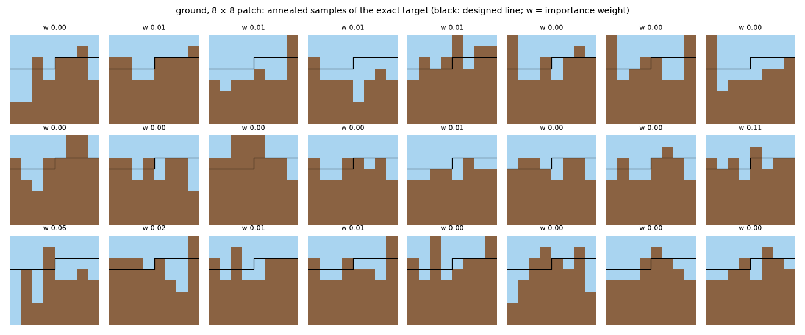
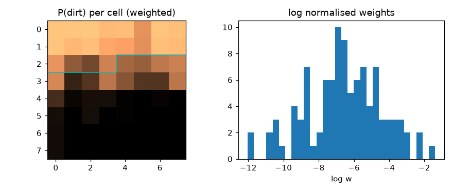

# Brute-force samples of the ground target (8 × 8 patch)

2026-10-14 · `mcmc.py` in this folder · Mac, one core, 5 minutes

**Setup.** Ground's factors (`castlegen/bench/problems/ground.py`) with T = 2: levels 0–2 on an 8 × 8 periodic patch (64 tiles), with rho and cert at levels 1–2. The fill is fixed by hand at 4/16 and 8/16 for the top blocks and 16/16 for the bottom blocks, with the designed line at rows 3 and 2.

**Sampler.** Annealed importance sampling:
- start from uniform random values;
- burn in at λ = 0.5;
- single-site Gibbs sweeps (exact local conditionals, colour classes in parallel) while λ rises geometrically to 60 over 150 steps, then to hard;
- weight log w = −Σ Δλ·H.

A parallel-tempering version was tried first. Its swaps into the hard replica never succeeded, so it was replaced.

**Result.**
- 102 independent samples, all valid and all distinct.
- Weighted dirt fraction 0.638; the importance-weight ESS is about 10 (out of 102).

**Reading.**
- **Shape:** the target is diverse and roughly follows the designed line, with dirt below and air above.
- **Roughness:** the surface is ragged, with single-column spikes and air shafts. The fill term only fixes per-block counts, and tile smoothness costs only 0.5 per mismatched neighbour.
- **Implication:** the learned samplers' all-dirt collapse is a training failure, not a property of the target. Whether this rough target is the intended look is a problem-design question for the user.
